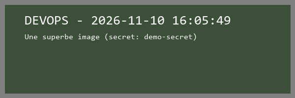

# Part 1 – Understanding the project and basic configuration

Goal of this part (from the TP subject):

1. **Analyse the PHP project**: read the source code to understand its structure and what it does.
2. **Configure the Docker environment**: understand the Docker setup and use it to run the app locally.

Date: 10/11/2026 – Work environment: Windows 11, Docker Desktop 29.8 (Linux engine), Git Bash.
We did **not** install PHP on our machine: everything (build, run, tests, linting) was done through Docker containers.

---

## 1. Analysis of the PHP project

### 1.1 What the application does

The application is very small. It has a single feature: when you open `/`, it **returns a PNG image** (600×200 px) that shows:

- a big text (`DEVOPS`) followed by the current date and time,
- a smaller text (`Une superbe image`),
- and, if the environment variable `APP_SECRET` is set, the value of that secret: `(secret: ...)`.

The last point is on purpose: it gives a visible way to check that a secret (later coming from Infisical) has really reached the application.



*Output of `http://localhost:8080/` from our container, started with `APP_SECRET=demo-secret`.*

### 1.2 Structure of the repository

| Path | Role |
|---|---|
| `public/index.php` | Entry point (web root). Loads Composer's autoloader, loads `.env` with phpdotenv, sends a `Content-type: image/png` header and calls `ImageCreator`. The colors and texts can be changed at the top of the file. |
| `public/info.php` | Calls `phpinfo()`. Debug page only. |
| `public/font/consolas.ttf` | Font used to draw the text with GD. |
| `src/ImageCreator.php` | The only class (`App\ImageCreator`, PSR-4 autoload `App\ → src/`). Builds the image with the GD extension. |
| `tests/Unit`, `tests/Feature` | PHPUnit tests (namespace `Tests\`). |
| `composer.json` / `composer.lock` | Dependencies. |
| `phpunit.xml` | PHPUnit config, with two test suites: `Unit` and `Feature`. |
| `phpcs.xml` | Coding style rules: PSR-12 + PHPCompatibility. |
| `Docker/Dockerfile` | Image of the application (PHP 8.2 + Apache). |
| `.dockerignore` | Files not sent to the Docker build. |
| `.circleci/config.yml` | CI/CD pipeline (studied in detail in Part 2). |
| `.env.example` | Template for the `.env` file (only `APP_SECRET=`). |

### 1.3 How a request is handled

```
Browser ──GET /──▶ Apache (DocumentRoot = /var/www/html/public)
                     │
                     ▼
               public/index.php
                 ├─ require vendor/autoload.php      (Composer)
                 ├─ Dotenv::createImmutable()->safeLoad()   (.env is optional)
                 ├─ header("Content-type: image/png")
                 └─ new App\ImageCreator(colors, texts)
                       ├─ imagecreatetruecolor(600, 200)        (GD)
                       ├─ text = "DEVOPS - " + Carbon now()      (nesbot/carbon)
                       ├─ + " (secret: …)" if $_ENV['APP_SECRET'] is set
                       └─ createImage(): 2 rectangles + 2 texts (imagettftext) → imagepng()
```

### 1.4 Dependencies

| Package | Type | Why |
|---|---|---|
| `php >= 8.2.0` | platform | The code uses PHP 8 syntax (e.g. return type `false\|int`). |
| `ext-gd` | extension | Drawing the image (`imagecreatetruecolor`, `imagettftext`, …). Needs FreeType for TTF fonts. |
| `nesbot/carbon` 2.72.1 | runtime | Date/time formatting. |
| `vlucas/phpdotenv` 5.6.0 | runtime | Reads the `.env` file into `$_ENV`. |
| `phpunit/phpunit` 10.5.2 | dev | Unit tests. |
| `roave/security-advisories` | dev | Meta-package that **refuses to install** any dependency version with a known vulnerability. A cheap first security barrier. |

### 1.5 Tests and code quality

- Tests: both `ExampleTest.php` files only contain `assertTrue(true)`. They pass (2 tests, 2 assertions), but they **do not test the application at all**.
- `phpcs.xml`: PSR-12 + PHPCompatibility. We ran it (see 1.6): **7 errors** in 4 files (missing newline at end of file, double space before an argument, test method names in `snake_case`, …). 5 of them can be fixed automatically with `phpcbf`.

### 1.6 Commands we ran to check the analysis

Since PHP is not installed locally, we ran the tools in a temporary container based on our app image (dev dependencies installed in `/tmp`, so our working copy is not modified):

```bash
docker run --rm -v "$(pwd -W):/app:ro" devsecops-tp3:local bash -c '
  cp -r /app /tmp/w && cd /tmp/w && rm -rf vendor
  composer install
  ./vendor/bin/phpunit
  composer require --dev "squizlabs/php_codesniffer=*" "phpcompatibility/php-compatibility=*" -W
  ./vendor/bin/phpcs --standard=phpcs.xml --extensions=php --ignore=vendor/ .'
```

Results:

```
OK (2 tests, 2 assertions)

public/info.php:3            Expected 1 newline at end of file; 0 found
tests/Feature/ExampleTest.php:3   Header blocks must be separated by a single blank line
tests/Feature/ExampleTest.php:15  Method name "ExampleTest::test_example" is not in camel caps format
tests/Unit/ExampleTest.php:14     Method name "ExampleTest::test_example" is not in camel caps format
src/ImageCreator.php:27      Expected 1 space between type hint and argument "$yourColor"; 2 found
src/ImageCreator.php:28      Expected 1 space between type hint and argument "$yourColor2"; 2 found
src/ImageCreator.php:71      Expected 1 newline at end of file; 0 found
```

### 1.7 First look at the CI/CD pipeline

We only read it in this part; it will be configured in Part 2.

- `main_workflow`: `build-setup` (composer install + cache + workspace) → `lint-phpcs`, `security-check-dependencies`, `test-phpunit` in parallel. Then a manual `hold` approval → `deploy-ssh-staging` (branches `release/*`) or `deploy-ssh-production` (`main`/`master`).
- `container_workflow`: `build-docker-image` builds the image and pushes it to GHCR as `ghcr.io/<user>/<repo>:<branch>`.

### 1.8 Problems found during the analysis

| # | Problem | Proof | What we did |
|---|---|---|---|
| A1 | CI executors use `cimg/php:8.1`, but `composer.json` needs `php >= 8.2`. `build-setup` will fail. | `docker run cimg/php:8.1 … composer install` → *"Root composer.json requires php >=8.2.0 but your php version (8.1.34) does not satisfy that requirement."* | Noted, fixed in Part 2. |
| A2 | Job `deploy-ssh-production` is used in the workflow but not defined. CircleCI will reject the config. | `.circleci/config.yml` | Expected by the subject, done in Part 3. |
| A3 | `lint-phpcs` turns exit codes 1 and 2 into success: style errors never break the build. | 7 errors found, job would still be green. | Noted for Part 2/3. |
| A4 | `phpunit.xml` coverage `<source>` points to `./app`, but the code is in `./src`. | `phpunit.xml` | Noted for Part 2. |
| A5 | Tests are placeholders (`assertTrue(true)`). | `tests/` | Noted. |
| A6 | `phpcs.xml` checks compatibility with PHP 7.4+, while the project needs 8.2. | `testVersion="7.4-"` | Noted. |
| A7 | `public/info.php` is reachable and **shows the value of `APP_SECRET`** (and the whole server config). | `curl http://localhost:8080/info.php` → HTTP 200, `demo-secret` appears in the page. | Noted for Part 5 (must be removed/blocked in production). |
| A8 | `APP_SECRET` is printed on the image. | Screenshot above. | Intended for the exercise; never do this with a real secret. |

---

## 2. Docker environment

### 2.1 How the Dockerfile works (original version)

`Docker/Dockerfile`, step by step:

1. **Base image** `php:8.2-apache` (Debian 13 "trixie", Apache + mod_php).
2. **OCI labels** filled from build args (`GIT_COMMIT`, `GIT_URL`, `TAG`, `BUILD_DATE`…). The CI passes these args, so each image on GHCR can be traced back to its commit.
3. **System packages** for GD (`libpng`, `libjpeg`, `libfreetype`), zip, wget…
4. **SQLite 3.43.2 compiled from source** (version given by `SQLITE_VERSION`/`SQLITE_YEAR`). Not used by the current app, it is ready for a future database (`DATABASE_DRIVER=sqlite`).
5. **Xdebug 3.3.0** via PECL.
6. **PHP extensions**: `gd` (with FreeType + JPEG), `pdo`, `pdo_mysql`, `zip`, `pdo_sqlite`.
7. **Infisical CLI**, to fetch secrets at runtime (Part 2).
8. **Composer** installer.
9. Apache: enable `mod_rewrite` and set the DocumentRoot to `/var/www/html/public`, so only `public/` is exposed (not `src/`, `vendor/`, `.env`…).
10. `COPY . /var/www/html`, `chown www-data`, `EXPOSE 80`.

`.dockerignore` keeps out of the build context: `.git`, `.circleci`, IDE folders, `.env*` (except `.env.example`), `vendor`, the Docker files. Good point: **no `.env` file can end up inside the image**.

### 2.2 First build: it fails

```bash
docker build -f Docker/Dockerfile -t devsecops-tp3:original .
```

```
 > [ 6/15] RUN apt-get install -y bash curl && curl -1sLf 'https://dl.cloudsmith.io/public/infisical/infisical-cli/setup.deb.sh' | bash ...
3.794 E: Unable to locate package infisical
ERROR: failed to build: ... exit code: 100
```

The Infisical CLI is not available anymore from the Cloudsmith repository used in the Dockerfile. Infisical moved its packages to `artifacts-cli.infisical.com`. We checked the new repository in a bare `php:8.2-apache` container before changing the Dockerfile:

```bash
docker run --rm php:8.2-apache bash -c "curl -1sLf 'https://artifacts-cli.infisical.com/setup.deb.sh' | bash; apt-get update; apt-cache policy infisical"
# infisical:  Candidate: 0.45.4
```

### 2.3 Other problems in the Docker setup

| # | Problem | Impact |
|---|---|---|
| D1 | Infisical repository URL is dead (see above). | The image cannot be built at all. |
| D2 | `vendor/` is excluded by `.dockerignore`, and the Dockerfile installs Composer but **never runs `composer install`**. | Even if the build succeeded, `index.php` would crash on `require vendor/autoload.php`. |
| D3 | The folder is named `Docker/` but the CI uses `-f docker/Dockerfile`. | Works on Windows/macOS (case-insensitive), so it does not affect the local run, but it will **fail on the Linux CI runner**. CI job → left for Part 2. |

### 2.4 Changes we made

**1. Infisical install (D1)** – `Docker/Dockerfile`

```dockerfile
RUN apt-get install -y bash curl \
    && curl -1sLf 'https://artifacts-cli.infisical.com/setup.deb.sh' | bash \
    && apt-get update \
    && apt-get install -y infisical
```

**2. Install the PHP dependencies inside the image (D2)** – `Docker/Dockerfile`

```dockerfile
WORKDIR /var/www/html

COPY composer.json composer.lock /var/www/html/
RUN composer install --no-dev --no-scripts --no-autoloader --prefer-dist --no-interaction --no-progress

COPY . /var/www/html
RUN rm -Rf /var/www/html/docker
RUN composer dump-autoload --optimize --no-dev
```

Choices:
- We copy `composer.json` + `composer.lock` **before** the source code. Docker caches this layer, so changing a PHP file does not reinstall all dependencies (faster builds, also in CI).
- `composer.lock` is used, so the image always has the exact same versions as our tests.
- `--no-dev`: PHPUnit and the other dev tools are not shipped in the image (smaller image, less attack surface).
- `dump-autoload --optimize`: class map autoloader, faster in production.

**3. Folder case (D3)** – not changed in Part 1: it only matters for the CircleCI `build-docker-image` job, which is Part 2.

**4. `docker-compose.yml`** (new, local use only) so that the whole team runs the app the same way:

```yaml
services:
  app:
    build:
      context: .
      dockerfile: Docker/Dockerfile
    image: devsecops-tp3:local
    ports:
      - "8080:80"
    environment:
      APP_SECRET: ${APP_SECRET:-}
```

The secret is not written in the file: it comes from the shell or from a local `.env` file (git-ignored).

### 2.5 Running the application locally

With Docker Compose:

```bash
docker compose up --build        # http://localhost:8080
docker compose down
```

Or with plain Docker:

```bash
docker build -f Docker/Dockerfile -t devsecops-tp3:local .
docker run --rm -p 8080:80 -e APP_SECRET=demo-secret devsecops-tp3:local
```

### 2.6 Verification

| Check | Command | Result |
|---|---|---|
| Image builds | `docker build -f Docker/Dockerfile …` | OK (~1 min 50 s from scratch) |
| App responds | `curl -D - http://localhost:8080/` | `HTTP/1.1 200 OK`, `Content-Type: image/png`, 600×200 PNG |
| Secret reaches the app | `-e APP_SECRET=demo-secret` | `(secret: demo-secret)` printed on the image (screenshot in 1.1) |
| Compose works | `docker compose up -d` + `curl` | `HTTP 200 image/png` |
| Versions in the image | `docker exec … php -v`, `sqlite3 --version`, `infisical --version`, `composer --version` | PHP 8.2.35, SQLite 3.43.2, Infisical 0.45.4, Composer 2.11.2 |
| Extensions | `php -m` | `gd`, `pdo_sqlite`, `xdebug` present |
| Dev deps not shipped | `ls vendor` | only runtime packages (carbon, phpdotenv, symfony, …), no phpunit |

### 2.7 Remarks kept for Part 5 (security)

Things we noticed but did not change yet, because they are part of the security work later:

- **Image size: 1.12 GB.** A lot of it is build tools (compilers for SQLite/Xdebug) that stay in the final image. A multi-stage build would reduce it.
- **Xdebug is installed and enabled in the image** that will go to production. It should only be in a dev image.
- **`info.php` is shipped** and leaks every environment variable, including secrets (A7).
- **Several `curl | bash` installs** (Infisical script, Composer installer) and the SQLite tarball are downloaded **without checksum verification**.
- `apt-get install` without pinned versions and base image `php:8.2-apache` without digest: two builds can give different images.
- No `HEALTHCHECK`, and no image scan yet (Trivy / Docker Scout planned in Part 5).
- Default Apache shows its version in headers (`Server: Apache/2.4.69 (Debian)`, `X-Powered-By: PHP/8.2.35`): information disclosure.

---

## 3. Summary of Part 1

- We understood the app: one PHP class drawing a PNG with GD, dates with Carbon, config with phpdotenv, and a secret shown on purpose to test secret management.
- The Docker image **did not build** (dead Infisical repository) and **would not have run** (no `composer install`). Both are fixed; the app now runs locally with `docker compose up --build`.
- We listed the problems we will need to fix in the next parts (PHP 8.1 in CI, `Docker/` vs `docker/` path in CI, missing production deploy job, lint that never fails, wrong coverage path, empty tests) and the security points for Part 5.

### Files changed in this part

| File | Change |
|---|---|
| `Docker/Dockerfile` | New Infisical repo; `composer install` + optimized autoloader. |
| `docker-compose.yml` | New, for local runs. |
| `README.md` | Docker section and known issues updated. |
| `doc/` | This documentation + screenshot. |
